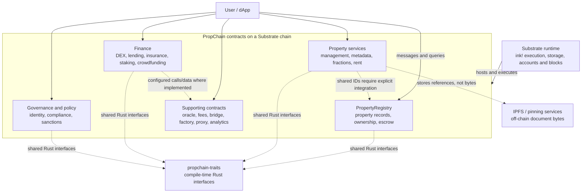
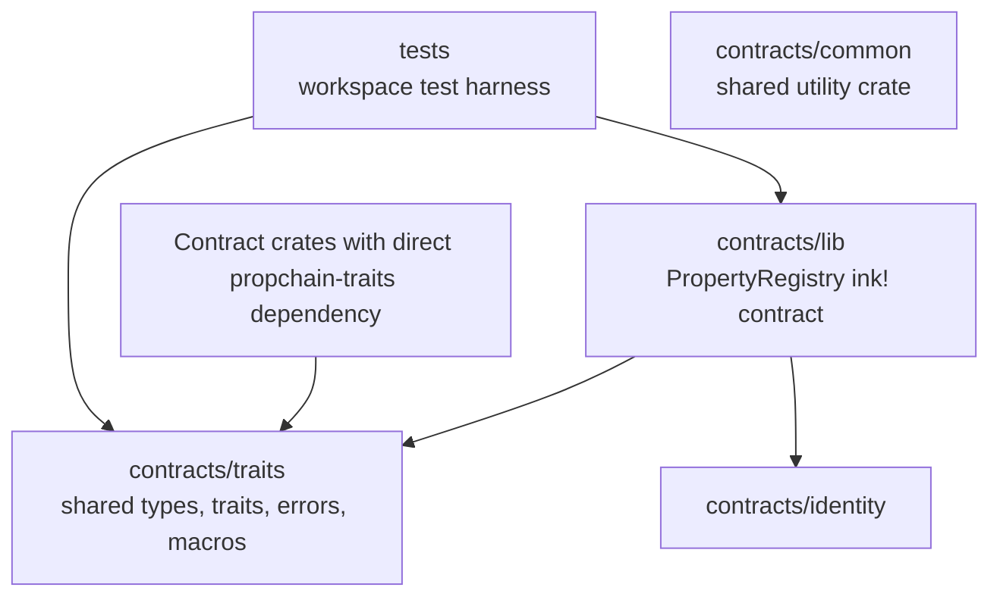
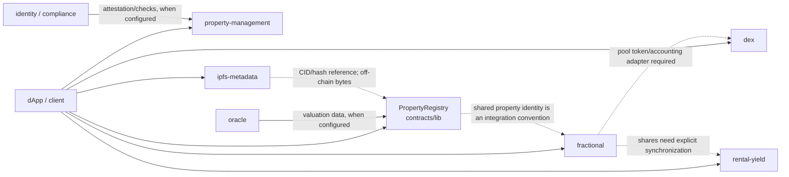

# PropChain Contract Architecture

This guide maps the Cargo workspace as it exists in the root [`Cargo.toml`](../../Cargo.toml), explains the shared contract interface layer, and gives a deployment-oriented view of the modules. It complements the repository's [`ARCHITECTURE.md`](../../ARCHITECTURE.md); the root document has a useful conceptual map, while the tables below include every current workspace member.

## System context

PropChain is a set of independently deployed ink! contracts plus Rust libraries and test/tooling crates. The application is not one monolithic contract: users and clients call the deployed contract whose state or operation they need. Cross-contract calls are possible where a contract has a configured address and a compatible ink! interface, but a Cargo dependency on `propchain-traits` alone does not deploy or call another contract.

The diagram is a logical system boundary, not a guarantee that every edge is an implemented contract-to-contract call. In particular, property NFTs, fractional balances, DEX reserves, and rental-yield share records are currently separate state systems; see [Property Tokenization and Fractional Ownership](./PROPERTY_TOKENIZATION_AND_FRACTIONAL_OWNERSHIP.md) for the precise boundaries.

## Workspace member inventory

Each row is a path listed in the workspace `members` array. There are 34 members: 31 crates under `contracts/` and three other workspace members used for analysis or testing. The support crates are not deployed contracts.

| Workspace member | Role |
|---|---|
| `contracts/lib` | `propchain-contracts`; includes the `PropertyRegistry` ink! contract, property records, transfer/escrow flows, and re-exports shared types. |
| `contracts/traits` | `propchain-traits`; shared Rust interfaces, data types, errors, access-control and reentrancy primitives. Not a deployed contract. |
| `contracts/proxy` | Upgradeable proxy and implementation routing. |
| `contracts/factory` | Contract deployment/factory templates and deployment orchestration. |
| `contracts/ipfs-metadata` | Property document metadata, CIDs, access rules, pin-state records and notarization data. |
| `security-audit` | Security-analysis support crate; not an on-chain contract. |
| `contracts/oracle` | Aggregates property valuation submissions and tracks source freshness/reputation. |
| `contracts/bridge` | Cross-chain bridge request, validator and token lock/unlock workflows. |
| `contracts/insurance` | Insurance policies, premiums, pools and claims. |
| `contracts/analytics` | On-chain analytics and aggregate metrics. |
| `contracts/fees` | Platform fee configuration and fee-related calculations. |
| `contracts/dex` | Pair pools, liquidity provision and swaps, with order and reward features. |
| `contracts/common` | Shared utilities used by Rust crates; not an independently deployed contract. |
| `contracts/compliance_registry` | Compliance records and checks consumed by application contracts. |
| `contracts/property-management` | Property operations such as leases, tenants, maintenance and expenses; its registration message is identity-gated. |
| `contracts/fractional` | Per-property fractional share balances, listings, buy/sell settlement, redemption and a share AMM. |
| `contracts/prediction-market` | Markets and positions for property-price predictions. |
| `contracts/identity` | Identity/KYC registry and attestations. |
| `contracts/governance` | Signer-based governance proposals, votes, thresholds and timelocks. |
| `contracts/crowdfunding` | Campaign creation, contributions and campaign settlement. |
| `contracts/lending` | Lending pools, applications, collateral and loan lifecycle. |
| `contracts/metadata` | Property metadata and metadata-related operations. |
| `contracts/multicall` | Batch dispatch of contract messages. |
| `contracts/database` | Generic on-chain key/value storage. |
| `contracts/third-party` | Third-party provider/registry integrations. |
| `contracts/staking` | Staking positions, validator delegation, rewards and staking governance. |
| `contracts/version-registry` | Contract version and deployment records. |
| `contracts/sanctions` | Sanctions screening and associated records. |
| `contracts/gdpr` | Data-erasure request workflow and related records. |
| `contracts/mock-oracle` | Deterministic oracle implementation for tests and controlled environments. |
| `contracts/monitoring` | Contract/system health and monitoring reports. |
| `contracts/rental-yield` | Rent deposits and proportional yield accounting/claims for property share holders. |
| `tests` | Workspace-level unit/integration/E2E test crate; not deployed. |
| `economic-models` | Economic models and Kani targets; not deployed. |

Contract roles above are intentionally short; check the respective crate's `src/` and README for its current message surface.

## Dependency and integration model

### Shared interface layer

`contracts/traits/` is the primary shared contract interface layer. Its modules define common property, oracle, DEX, fee, compliance, bridge, event, and error types. It also exposes primitives such as `AccessControl`, `ReentrancyGuard` and `non_reentrant!`. Contracts importing these types can agree on SCALE-encoded data without importing each other's implementation.

`contracts/common/` is a utility crate rather than an interface registry. `contracts/lib/` is different again: it is an ink! contract crate (package `propchain-contracts`) and also re-exports types from `propchain-traits`. It has direct manifest dependencies on both `propchain-traits` and `propchain-identity`.

The following contract crates declare a direct Cargo dependency on `propchain-traits`: analytics, bridge, compliance_registry, crowdfunding, database, dex, fees, fractional, gdpr, governance, identity, insurance, ipfs-metadata, lending, metadata, mock-oracle, monitoring, multicall, oracle, prediction-market, property-management, rental-yield, sanctions, staking, third-party and version-registry. That is a compile-time dependency list from their manifests, not a claim that each crate calls every other crate.

Runtime relationships require more care. For example, `PropertyRegistry` in `contracts/lib` can be configured with service addresses, and `property-management` checks an explicitly configured identity/compliance interface. A shared type or matching numeric `property_id` does not automatically connect contract storage.

### Main domain relationships

The dotted lines indicate integration work or shared identifiers, not automatic calls. The Fractional and DEX contracts each maintain their own balances/reserves, and RentalYield maintains its own share allocations.

## Key operation flow examples

### Staking and governance

`staking` tracks stake, validators/delegation, and rewards. It also contains staking-parameter proposal/voting functionality. The separate `governance` crate implements signer-based governance with proposals, voting thresholds and timelocks; it should not be confused with the staking crate's own parameter proposals. Where a system wants governance to control another module, the target address and action path must be explicitly implemented and configured.

### Property registration and financing

`PropertyRegistry` stores a property record with an owner and metadata; optional identity/compliance, oracle and fee services can be configured for related operations. `lending` and `insurance` are separate application contracts and use their own configuration and records. An oracle price is not proof of legal title, and the registry's property ID is not a fractional-token balance.

### Trading and yield

The DEX is a general pool/swap ledger keyed by token identifiers. The `fractional` contract separately has share listings and its own per-token share AMM. `rental-yield` records a manager-supplied share allocation and distributes deposited native value proportionally. An integrator must decide how to keep each of these state systems synchronized; see the tokenization guide for constraints and a complete lifecycle diagram.

## Deployment and initialization

The workspace does not enforce one universal deployment order: contracts can be deployed independently, and service addresses/roles are configured after deployment. The following is a dependency-aware operational sequence, not a protocol-enforced requirement:

1. **Build/prepare artifacts off-chain.** `traits`, `common`, `security-audit`, `tests` and `economic-models` are not deployable service contracts.
2. **Deploy identity and compliance services** if property onboarding requires them. Configure service roles and verify the check interface before relying on it.
3. **Deploy oracle and fee services** if the registry or financial modules will use them. Register sources, set freshness/quorum policy, and validate sample responses.
4. **Deploy `PropertyRegistry` (`contracts/lib`)** and configure optional identity, compliance, oracle, fee, or other service addresses through its available configuration messages. The constructor/admin and access-control state must be initialized and tested.
5. **Deploy domain contracts** such as `property-management`, `ipfs-metadata`, `fractional` and `rental-yield`. Configure access permissions and align property identifiers, supply and holder balances explicitly.
6. **Deploy financial/application contracts** such as DEX, lending, insurance, staking, crowdfunding and governance. Seed pools/parameters and set the service addresses required by each contract.
7. **Deploy infrastructure/operations modules** such as factory, proxy, bridge, version-registry, analytics and monitoring according to the deployment/upgrade plan.
8. **Run an on-chain smoke workflow.** Check role gating, a property lookup, any configured external service, and one representative operation for each configured contract before enabling user traffic.

For upgrades, use the proxy and version-registry procedures applicable to the deployed instance; do not assume that changing a Rust dependency updates deployed Wasm or migrates storage. Keep deployment addresses, code hashes, constructor inputs and post-deployment configuration in the release record.

## Further reading

- [`ARCHITECTURE.md`](../../ARCHITECTURE.md) — existing component map and interaction diagrams.
- [`contracts/traits/`](../../contracts/traits/) — shared interfaces and primitives.
- [`contracts/lib/src/lib.rs`](../../contracts/lib/src/lib.rs) — `PropertyRegistry` implementation.
- [`contracts/property-management/src/lib.rs`](../../contracts/property-management/src/lib.rs) — property operations and identity-gated registration.
- [`contracts/fractional/src/lib.rs`](../../contracts/fractional/src/lib.rs), [`contracts/dex/src/lib.rs`](../../contracts/dex/src/lib.rs), [`contracts/rental-yield/src/lib.rs`](../../contracts/rental-yield/src/lib.rs) — separate share, pool and yield accounting.
