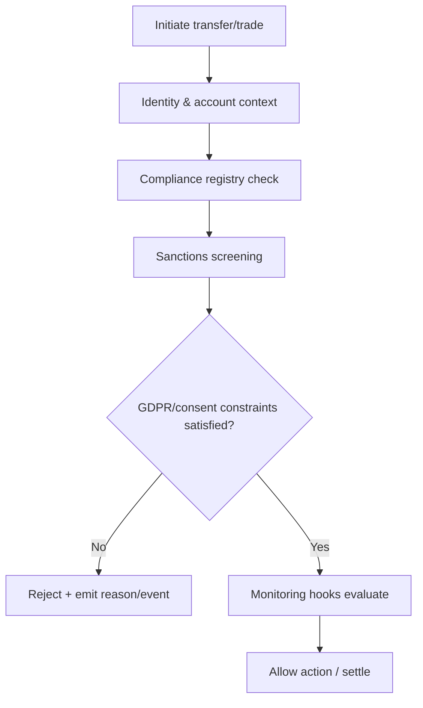
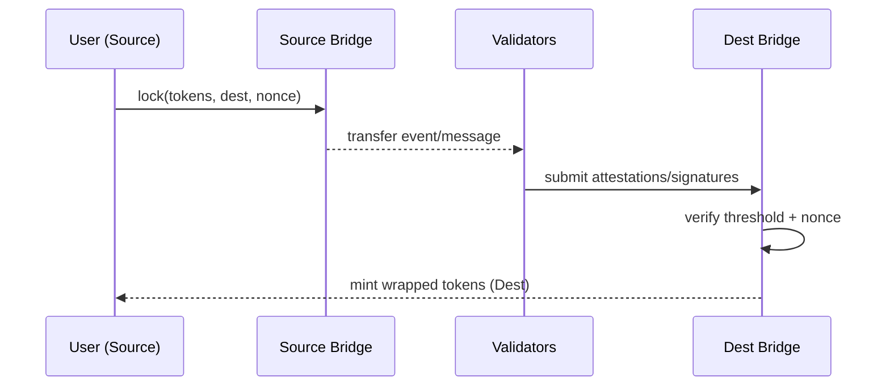
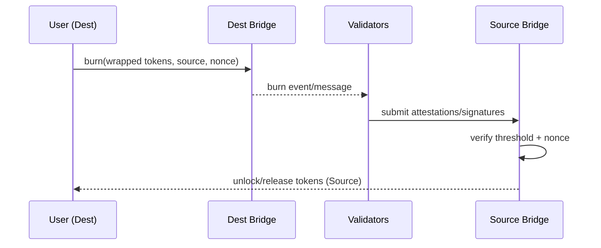

# Compliance, Sanctions, GDPR and Bridge Architecture Guide

This lean guide addresses:
- **#1498 Documentation: Compliance, Sanctions, and GDPR Integration Guide**
- **#1497 Documentation: Bridge Architecture and Cross-Chain Transfer Flows**

All content is scoped to `contract-extensions/docs/` and summarizes integration points from core PropChain contracts.

## 1. Compliance, sanctions, and GDPR integration (#1498)

### Compliance registry
- Reference: `contracts/compliance_registry/` (`lib.rs`, README).
- Maintains compliance-relevant records and checks used to gate regulated actions (e.g. transfers/trades) based on participant status and policy rules.

### Sanctions screening
- Reference: `contracts/sanctions/lib.rs`.
- Provides screening against sanctions/blocked entities. Lists and statuses are updated and queried through contract interfaces; consuming contracts should fail closed when screening cannot be satisfied.

### GDPR data management
- Reference: `contracts/gdpr/lib.rs`.
- Supports GDPR-related controls such as consent/processing records and right-to-erasure flows. On-chain erasure must be handled carefully (e.g. removing/obfuscating personal data pointers) while preserving required auditability where permitted.

### Integration with transfers, trades, identity, and monitoring
- **Transfers/trades:** compliance and sanctions checks are invoked before value movement or settlement to prevent restricted activity.
- **Identity:** `contracts/identity/lib.rs` provides identity/attribute context that compliance flows may rely on for verification and recovery-aware controls.
- **Monitoring:** `contracts/monitoring/` hooks can flag suspicious transaction patterns for review/escalation.

### Sanctions list updates and queries
- Authorized roles update list entries/state; read/query paths allow other contracts or off-chain systems to verify screening decisions. Access control around updates is critical.

### GDPR right-to-erasure impact
- Erasure requests affect personal/identifiable data handling; systems must balance deletion/anonymization with immutable ledger constraints and regulatory retention requirements.

### Compliance check flow (diagram)

## 2. Bridge architecture and cross-chain transfer flows (#1497)

### Architecture and validator consensus
- Reference: `contracts/bridge/`, `contracts/bridge/src/`, and `contracts/bridge/LIQUIDITY_POOLS.md`.
- Bridge operations rely on a validator set and a consensus/threshold policy for attestations before state transitions (lock/mint or burn/unlock) are finalized.

### Token locking/minting and liquidity model
- **Lock-mint:** tokens are locked on source chain; upon sufficient attestations, wrapped/represented tokens are minted on destination.
- **Burn-unlock:** wrapped tokens are burned on destination; verified attestations unlock/release on source.
- Liquidity pool considerations (where applicable) support transfer availability and risk management per `LIQUIDITY_POOLS.md`.

### Attestation, verification, and replay prevention
- Validators submit attestations/signatures over transfer messages.
- Verification checks signatures, thresholds, and message integrity.
- Replay protection uses nonces/unique message identifiers and processed-transfer tracking to reject duplicates.

### Oracle and cross-chain state verification
- Bridge-related oracle integration can provide/validate cross-chain state or pricing context where required by the flow and policy.

### Security considerations
- **Validator collusion:** threshold selection, staking/slashing (if applicable), and monitoring reduce risk.
- **Signature/message validation:** strict domain separation, nonce handling, and canonical encoding prevent forgery/replay.
- **Operational safety:** pause/limits/rate controls and audit logs help contain incidents.

### Sequence diagrams

#### Lock-mint flow

#### Burn-unlock flow

