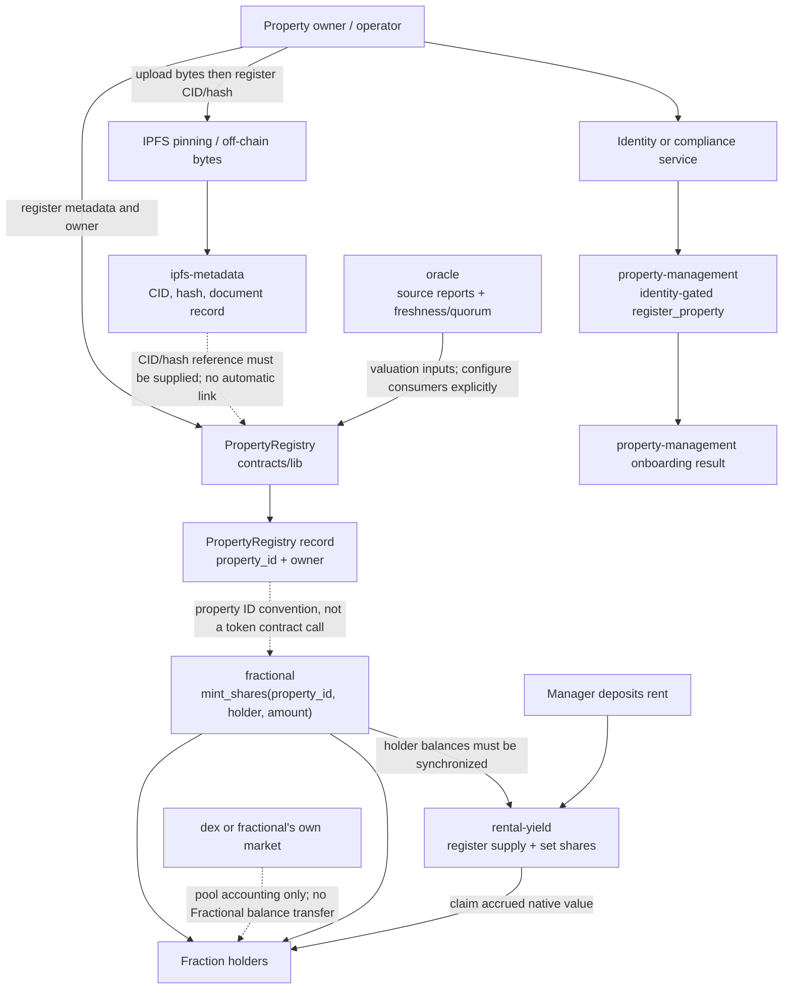
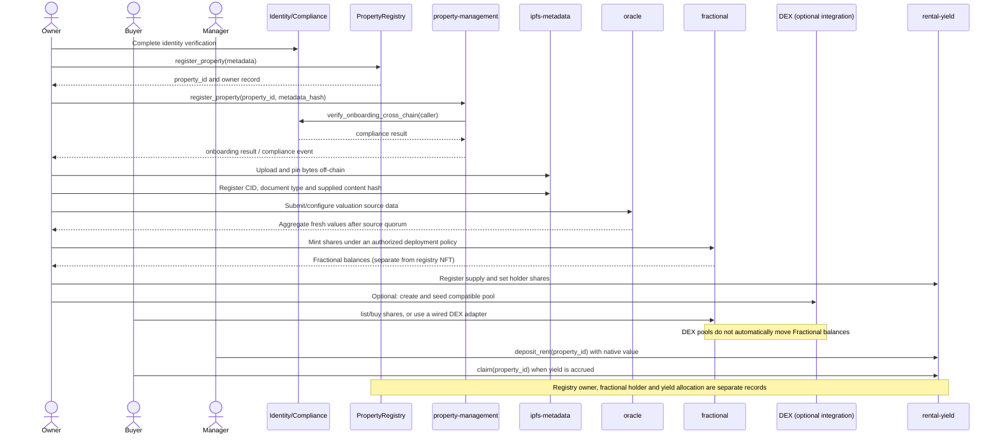

# Property Tokenization and Fractional Ownership

This guide follows the property lifecycle through the repository's property registry, identity-gated property-management entry point, document metadata, oracle valuation, fractional shares, trading and rental-yield distribution. It distinguishes implemented contract behavior from the integrations that an application must still wire together.

## At a glance

The picture is an end-to-end application flow, not a claim that these contracts automatically call one another. The identity gate, property record, fractional ledger, DEX pool and yield ledger are independently deployed and separately configured.

## 1. Register a property

### The registry/NFT record

The main property record and ownership flow is implemented by `PropertyRegistry` in [`contracts/lib/src/lib.rs`](../../contracts/lib/src/lib.rs). A client submits `register_property(metadata)` to the registry; the registry validates and stores the property metadata, allocates a property identifier and records the caller as owner. `get_property`, owner-property lookup and transfer/approval messages provide the subsequent ownership interface. Although this is commonly described as a property NFT, the registry code is a property record/ownership mapping; it does not implement a general NFT standard.

The shared [`PropertyMetadata`](../../contracts/traits/src/property.rs) has location, size, legal description, valuation and a document URL. This model is registry metadata; it is not the richer `PropertyMetadata` type defined independently by `contracts/ipfs-metadata`.

### The property-management message is an identity gate

[`contracts/property-management/src/lib.rs`](../../contracts/property-management/src/lib.rs) exposes `register_property(token_id, metadata_hash)`. Before emitting its compliance event, it calls `verify_onboarding_cross_chain(caller)`, which requires a configured identity registry and checks the caller through the shared `ComplianceChecker` interface. This message does not create or mint the canonical `PropertyRegistry` NFT: it accepts an identifier and hash and applies an onboarding gate.

For an application-level onboarding sequence, first establish the property record in the registry and configure the required identity/compliance address; then invoke the property-management registration gate for the chosen identifier. Do not treat successful onboarding as a substitute for checking the registry record, ownership or metadata.

## 2. Store document references with IPFS

[`contracts/ipfs-metadata/src/lib.rs`](../../contracts/ipfs-metadata/src/lib.rs) tracks document metadata on-chain, including property ID, CID, document type, content hash, file size, MIME type, encryption flag, uploader and timestamps. The document bytes are stored off-chain in IPFS; the contract does not fetch or pin content by making a network request. `pin_document` updates the registry's pin-state record and size accounting; the actual IPFS pinning service must be operated separately.

The caller supplies the `content_hash` at document registration. `verify_content_hash(document_id, provided_hash)` compares the supplied value with the hash already recorded on-chain. It cannot retrieve the CID's bytes and recompute a digest. A successful response therefore means “the provided hash matches the registered hash,” not “the IPFS bytes have been independently authenticated.” Treat a CID as a content address, preserve a trustworthy pinning receipt and perform byte/hash verification off-chain when required.

Avoid putting unencrypted sensitive personal information in public IPFS content. Use the contract's access controls and encryption metadata as additional workflow signals; they do not make public IPFS bytes private.

## 3. Valuate the property with oracle inputs

The [`oracle`](../../contracts/oracle/src/lib.rs) contract stores property valuation history, source configuration, freshness limits and aggregation policy. Its `aggregate_prices` path requires at least `min_source_quorum` price entries (two by default) before returning a value, and it filters outliers according to the configured mode/policy. The source comments describe this as a distinct-source quorum, but the visible gate checks the number of entries; do not assume repeated entries from one source are deduplicated without verifying the input path. Source registration, freshness limits and reputation are part of the trust model.

An oracle valuation is a market-data input, not a title record or independent legal appraisal. Consumers must configure the oracle address and check call results/freshness before using a valuation in lending, insurance, display or trading. Do not imply that changing the registry's metadata valuation automatically submits or updates an oracle price.

## 4. Convert whole-property ownership into fractional shares

The [`fractional`](../../contracts/fractional/src/lib.rs) contract stores balances under `(owner, token_id)` and a total share supply keyed by token ID. `mint_shares(owner, token_id, amount)` credits that balance and supply. Fractionalization means issuing a defined number of fungible accounting units associated by convention with the property's identifier; the fraction contract does not itself split or transfer the underlying registry NFT.

The current `mint_shares` message is public and the source comments describe it as used by tests or a property-token contract. It does not enforce that the caller owns the registry NFT, that `token_id` exists in `PropertyRegistry`, or that minted supply equals a registry-defined cap. Production deployments must not treat a token ID match as authorization: they need an authorized minter or equivalent integration/guardrail and a documented supply policy before using this interface for real ownership claims.

The whole-property registry record and fractional balances are therefore different assets and state:

| Item | Source of truth | What it represents |
|---|---|---|
| Property record/NFT-style ownership | `PropertyRegistry` in `contracts/lib` | Whole-property record and current owner |
| Property-management record/event | `property-management` | Identity-gated onboarding and ongoing operations |
| Fractional share balance | `fractional` | A holder's share units under a numeric token ID |
| Yield entitlement | `rental-yield` | The manager-configured share snapshot/accounting used to split rent |

The repository does not currently enforce a one-to-one relationship among these records. Align the IDs and supplies off-chain, restrict administrative minting, and define how NFT transfers, share transfers and outstanding yield allocations should interact.

## 5. Trade fractional ownership

There are two distinct trading surfaces in the source:

1. **Fractional contract market:** `list_shares_for_sale` records the seller's token ID, quantity and unit price. A buyer calls payable `buy_shares` with the seller and requested quantity, attaching enough native value. The contract checks listing expiry, quantity and payment, moves the share balance and updates/removes the listing. The same contract also has a share/value AMM and auction-related messages.
2. **DEX contract:** [`contracts/dex/src/lib.rs`](../../contracts/dex/src/lib.rs) creates generic token-pair pools with initial reserves and a fee. `swap_exact_base_for_quote` / `swap_exact_quote_for_base` run an AMM calculation, enforce a minimum output/slippage guard and update pool reserves.

The DEX source stores pool accounting and does not, by itself, call `fractional` to debit a trader's shares or credit the buyer. A pair whose `TokenId` is intended to identify fractional shares is not enough to effect token custody. To provide a truly atomic DEX market for shares, an adapter/escrow/contract-call path must validate share ownership and approvals, settle the fraction transfer, move quote value, and revert all effects on failure. Until such wiring exists, use the Fractional contract's own list/buy messages for its implemented share-ledger settlement, or describe a DEX integration as a separate future/application integration.

Use events such as `SharesListed`, `SharesSold`, `PoolCreated` and `SwapExecuted` as transaction/indexing signals, not as a substitute for verifying post-transaction balances and pool state.

## 6. Distribute rental yield

[`contracts/rental-yield/src/lib.rs`](../../contracts/rental-yield/src/lib.rs) maintains an independent share map and per-property `reward_per_share` accumulator.

1. An account with the `Manager` role calls `register_property(property_id, total_shares)` with non-zero supply.
2. A manager calls `set_shares(property_id, holder, amount)` for each holder. The contract first settles the holder's accrued amount against the old balance, then updates allocated shares and reward debt. New shares apply to future deposits, not already accrued rewards.
3. An authorized manager calls payable `deposit_rent(property_id)` with attached native value. The property must have allocated shares and the contract must not be paused. The deposit increases the per-share accumulator; rounding dust is tracked as `remainder`.
4. Each holder calls `claim(property_id)`. The contract settles the holder's accumulated amount, clears the pending balance, and transfers native value under its reentrancy guard.

The share map in this contract is not automatically synchronized with `fractional::balance_of`. If shares are traded, an operator or integration must update RentalYield allocations in a way that preserves already-accrued claims and does not allocate above total supply. Because `set_shares` settles before changing shares, update timing matters; define and test the snapshot policy before using live transfers.

## End-to-end sequence and state boundaries

## Operational checks

- Verify the registry record and owner before fractionalizing it.
- Verify identity and compliance service configuration before registering through `property-management`.
- Store only safe document data on public IPFS; validate CIDs, sizes and MIME types, and verify bytes off-chain.
- Use fresh, quorum-backed oracle data and document the valuation denomination/time.
- Lock down any path that can mint shares; confirm total supply and the intended owner/claim policy.
- Exercise the chosen market's settlement path and verify both asset balances, not only events.
- Reconcile RentalYield's allocated shares with the supported snapshot policy after every ownership change.
- Ensure all payable messages receive the expected transferred value and that failed claims/transfers do not silently succeed.
