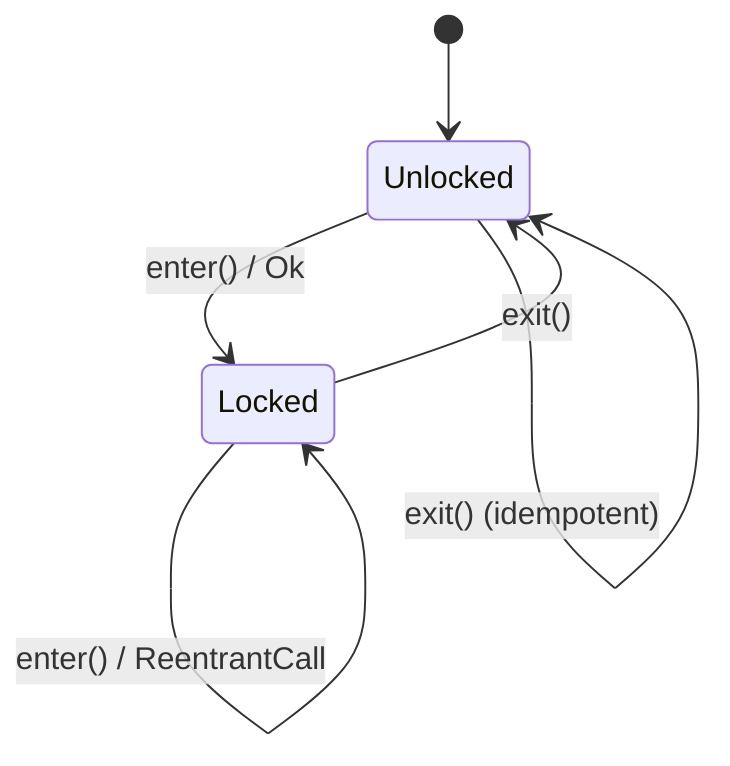

# Reentrancy Guard: Implementation and Usage

This guide describes the shared ink! reentrancy primitive, the contract-specific error mapping pattern, and how to apply and test the guard. The implementation is in [`contracts/traits/src/reentrancy_guard.rs`](../../contracts/traits/src/reentrancy_guard.rs); related repository notes are listed under [Further reading](#further-reading).

## What the guard does

`propchain_traits::ReentrancyGuard` is a storage-compatible struct containing one `locked: bool`. `enter()` returns `Ok(())` and marks it locked when unlocked; a second `enter()` returns `ReentrancyError::ReentrantCall`. `exit()` clears the flag, and `is_locked()` reads it. The exported `non_reentrant!` macro enters the guard, evaluates the message body in a closure, exits after the closure returns, and then returns the body's result.



The guard blocks a protected entry point from being entered again while that entry point is in progress. It does not replace authorization, checks-effects-interactions, validation, or careful handling of external calls. Only state-mutating messages with a reentrancy risk need protection; read-only queries normally do not.

## `ReentrancyError` and conversion to a contract error

The shared error enum currently has one variant:

```rust
pub enum ReentrancyError {
    ReentrantCall,
}
```

The `?` in `non_reentrant!` propagates this error. Each contract whose message returns its own error type implements `From<propchain_traits::ReentrancyError>` so the `?` has a defined conversion:

```rust
impl From<propchain_traits::ReentrancyError> for Error {
    fn from(_: propchain_traits::ReentrancyError) -> Self {
        Error::ReentrantCall
    }
}
```

This is the pattern used in [`contracts/staking/src/lib.rs`](../../contracts/staking/src/lib.rs). `contracts/property-management`, `contracts/dex` and `contracts/rental-yield` also map the shared error to their local `ReentrantCall` variant. Keep the mapping explicit: the application error enum remains the public SCALE-encoded result for that contract.

## Add a guard to a new contract

1. **Add the guard to contract storage.** Import the shared primitive and add a `ReentrancyGuard` field to the `#[ink(storage)]` struct.
2. **Initialize every constructor.** Use `ReentrancyGuard::new()` so each new contract instance starts unlocked. Do not call `enter()` in the constructor.
3. **Add a local error variant.** Add a contract-specific `ReentrantCall` (or repository-standard equivalent) to the returned error enum.
4. **Implement conversion.** Add `From<ReentrancyError> for Error` as above.
5. **Select the risky entry points.** Protect external/value-moving or callback-capable state changes, such as a withdrawal, claim, token transfer or message that calls an untrusted contract. Avoid adding the guard indiscriminately to views.
6. **Wrap the entire critical operation.** Use `non_reentrant!(self, { ... })` so guard lifetime includes checks, state effects and external calls.
7. **Use checks-effects-interactions.** Validate first, update relevant accounting before an external interaction, then perform the call/transfer. If the interaction fails, explicitly restore or otherwise safely reconcile prior effects before returning an ordinary `Err`; do not assume that returning `Result::Err` automatically reverts contract storage.
8. **Keep helper scope deliberate.** A private helper called from the protected message should usually be unguarded. If both an entry point and a same-instance helper enter this same guard, the nested entry will fail by design.
9. **Test both paths.** Confirm a normal call succeeds and leaves the guard unlocked, and a nested call is rejected without corrupting application state.

### Correctly guarded message

```rust
use propchain_traits::{non_reentrant, ReentrancyError, ReentrancyGuard};

#[ink(storage)]
pub struct Vault {
    balance: Balance,
    reentrancy_guard: ReentrancyGuard,
}

#[derive(Debug, PartialEq, Eq, scale::Encode, scale::Decode)]
pub enum Error {
    InsufficientBalance,
    TransferFailed,
    ReentrantCall,
}

impl From<ReentrancyError> for Error {
    fn from(_: ReentrancyError) -> Self {
        Error::ReentrantCall
    }
}

impl Vault {
    #[ink(constructor)]
    pub fn new() -> Self {
        Self {
            balance: 0,
            reentrancy_guard: ReentrancyGuard::new(),
        }
    }

    #[ink(message)]
    pub fn withdraw(&mut self, amount: Balance) -> Result<(), Error> {
        non_reentrant!(self, {
            if amount > self.balance {
                return Err(Error::InsufficientBalance);
            }

            let recipient = self.env().caller();
            let previous_balance = self.balance;
            self.balance -= amount;
            if self.env().transfer(recipient, amount).is_err() {
                self.balance = previous_balance;
                return Err(Error::TransferFailed);
            }
            Ok(())
        })
    }
}
```

This is an illustrative pattern, not a drop-in replacement for a contract's established balance accounting. The explicit restore is important because returning an ordinary error is not, by itself, a storage rollback. Test the target environment's transfer-failure semantics.

### Incorrect patterns

**No guard around the external call:** a recipient callback may enter the same message before accounting is complete.

```rust,ignore
#[ink(message)]
pub fn withdraw(&mut self, amount: Balance) -> Result<(), Error> {
    self.env().transfer(self.env().caller(), amount)?;
    self.balance -= amount;
    Ok(())
}
```

**Manual enter followed by early `?` or return:** without a cleanup path, a returned error can leave the in-memory guard locked. Prefer the macro, which runs `exit()` after the closure produces either `Ok` or `Err`.

```rust,ignore
self.reentrancy_guard.enter()?;
do_fallible_work()?; // exits before the later manual exit
self.reentrancy_guard.exit();
```

**Guarding only the transfer line:** this leaves preceding state changes or callback-capable calls outside the protected scope. Put all operations whose invariants must be atomic inside one wrapped body.

## Scope, constructors and nested calls

- **Constructors:** initialize the guard as unlocked. A constructor is creating the instance, not entering a user operation that needs a reentrant-entry lock.
- **Scope:** keep the guard active throughout the critical section, including callback-capable external calls. A block that exits the guard before an external interaction does not protect that interaction.
- **Nested entry points:** a single guard is non-recursive. If a guarded message calls another public message that uses the same guard, that second message receives `ReentrantCall` even if the call was intentional. Factor shared implementation into a private, unguarded helper and guard only the public entry point.
- **Internal helper calls:** a private helper does not require a separate `non_reentrant!` wrapper when it is only called within the protected entry point.
- **Read-only messages:** do not mutate the lock or add the guard to views without a specific reason.
- **Errors and panics:** the macro clears the flag after the body returns, including an ordinary `Err`. An ordinary `Err` is not a storage rollback: undo or reconcile state changes before returning it. A panic aborts/reverts the message under the normal ink! execution model; do not rely on a panicking path as regular cleanup.
- **Storage/upgrades:** the guard is a field in the contract's storage layout. Adding it to an already deployed contract changes that layout; use the repository's applicable proxy/migration process rather than assuming a source-only upgrade is safe.

## Gas and storage overhead

The guard adds a `bool` field and storage access to each guarded path. The source-level operations are one lock read and write during `enter()`, followed by one write in `exit()`; the macro adds no collection allocation or loop. Actual gas/weight depends on the chain, storage cache and surrounding message, so the repository does not promise a fixed numeric gas surcharge. Measure the complete guarded and unguarded path with the target node/runtime before setting a budget.

The repository note [`REENTRANCY_GUARD_ERRORS_EVENTS_GAS.md`](../../docs/REENTRANCY_GUARD_ERRORS_EVENTS_GAS.md) provides the same operation-level accounting. Do not confuse that qualitative estimate with a measured benchmark.

## Testing reentrancy

The shared primitive has focused tests in `contracts/traits/tests/reentrancy_guard_errors.rs` and `reentrancy_guard_unit_fuzz.rs`. The vault-style test in `contracts/traits/tests/reentrancy_guard_integration.rs` models a nested call, checks `ReentrantCall`, verifies that the balance is unchanged, and verifies that the guard is unlocked after the outer call completes.

For each contract integration:

1. Test the normal protected operation and expected balance/state change.
2. Add a test harness that re-enters the protected entry point while the outer call is active (a direct guard model for fast unit coverage, or a malicious callback contract for an actual ink! cross-contract path).
3. Assert the nested call returns the local `ReentrantCall` error.
4. Assert no duplicate transfer/accounting change occurred.
5. Assert a completed call leaves the guard unlocked so a later valid call still succeeds.
6. Test failures after entering the macro body; a returned `Err` should not poison future calls.

A model test exercises the lock semantics but is not a substitute for an E2E callback test where the production contract makes an external call. Keep the reentrant actor and call path as close as possible to the real message being protected.

## Further reading

- [`contracts/traits/src/reentrancy_guard.rs`](../../contracts/traits/src/reentrancy_guard.rs) — implementation and macro.
- [`contracts/staking/src/lib.rs`](../../contracts/staking/src/lib.rs) — `From<ReentrancyError>` pattern.
- [`REENTRANCY_GUARD_AUDIT.md`](../../docs/REENTRANCY_GUARD_AUDIT.md) — access-control review and primitives.
- [`REENTRANCY_GUARD_REVIEW.md`](../../docs/REENTRANCY_GUARD_REVIEW.md) — usage/review notes and unit test references.
- [`REENTRANCY_GUARD_ERRORS_EVENTS_GAS.md`](../../docs/REENTRANCY_GUARD_ERRORS_EVENTS_GAS.md) — error mapping and qualitative gas accounting.
- [`REENTRANCY_GUARD_UPGRADE_AND_OVERFLOW.md`](../../docs/REENTRANCY_GUARD_UPGRADE_AND_OVERFLOW.md) — storage and deployment notes.
